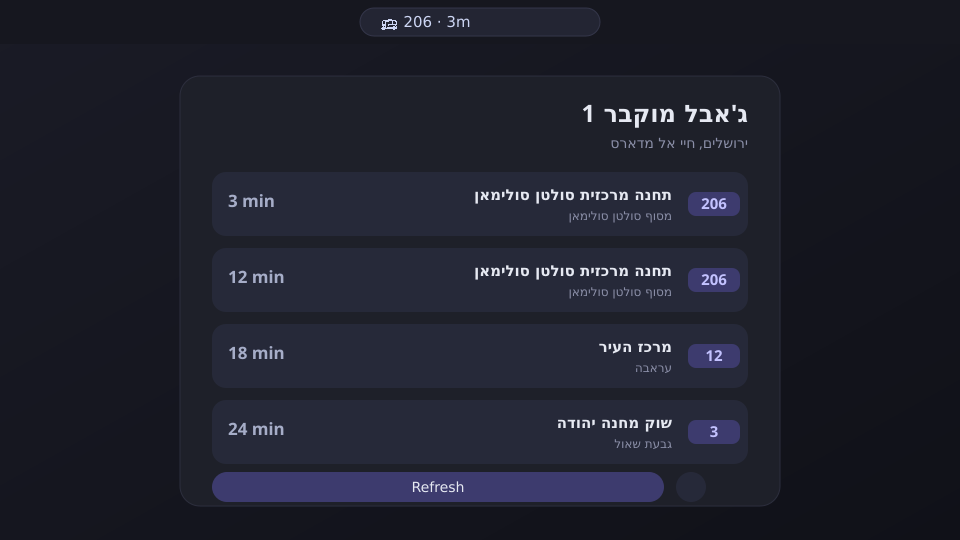

# Israel Transit

A bar widget that shows the next bus arriving at an Israeli transit stop. Click it to open a panel with the full upcoming schedule for the stop.

## Features

- **Bar widget** — bus glyph, soonest route number and ETA at a glance (e.g. `541 · 3m`), with a tooltip showing the stop and the next arrival
- **Panel** — stop name, street, city and code, plus every upcoming arrival in the monitoring window: route number, destination, origin, vehicle plate number and ETA
- **Configurable stop** — set any Israeli stop number (the code printed on the stop sign)
- **Configurable refresh rate** — polls real-time arrivals every 10–300 seconds
- **Configurable monitoring window** — look 10–90 minutes ahead
- **Self-hostable API** — point it at your own instance of the [Israel public transport API](https://github.com/benyaming/israel-public-transport-api); defaults to the hosted instance
- **Stale-data fallback** — if a refresh fails, arrivals from the last successful fetch stay visible while they have not departed yet: the bar switches to a warning glyph and the panel shows an error banner with the last known schedule. Both clear on the next successful fetch
- **English + Hebrew UI** (stop and route names come from the API in Hebrew)

## Data source

Arrivals come from the [Israel public transport API](https://github.com/benyaming/israel-public-transport-api) (GTFS + real-time SIRI feeds from the Israeli Ministry of Transport), hosted at `https://api.ginzburg.io/il_transport`. You can self-host the project and set the base URL in the plugin settings.

## Settings

| Setting | Scope | Description | Default |
|---|---|---|---|
| Stop number | plugin | Public stop code, e.g. `5200` | *(empty — widget shows `transit: set stop`)* |
| Stop number | widget | Per-instance override; empty falls back to the plugin-level stop | *(empty)* |
| Refresh interval | plugin | Poll cadence in seconds (10–300) | `30` |
| Monitoring window | plugin | How far ahead to look, in minutes (10–90) | `30` |
| API URL | plugin | Base URL of the transit API (advanced) | hosted instance |

## Usage

1. Install the plugin and add the **Israel Transit** widget to a bar.
2. Set your stop number: right-click the widget for the per-instance setting, or use **Settings → Plugins → Israel Transit** for the plugin-level default. A widget value, when non-empty, overrides the plugin-level one.
3. The bar shows the soonest arrival; click the widget to open the full schedule panel. The panel refreshes immediately when opened and keeps updating while open; its header has buttons for settings and manual refresh.
